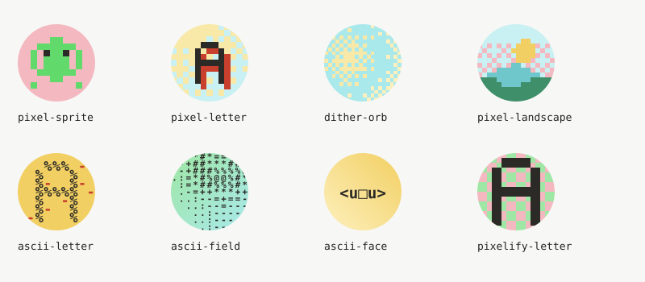

# dither-face

**Deterministic pixel and ASCII avatars. One seed, eight styles, zero runtime dependencies.**

Turn a user ID into a standalone SVG, on the server or in the browser. No avatar service, image storage, account, or network request required. An independent, MIT-licensed sister project of [Palletism](https://palletism.art).



> **0.x preview.** This repository is preparing its public package and site launch. The intended site is `https://ditherface.palletism.art`; release and hosting availability are not implied by these instructions. Before 1.0, minor releases may change the API or avatar output. Pin an exact version when identities need to stay stable across upgrades.

## Quick start

After the public npm release:

```sh
npm install dither-face
```

```ts
import { ditherFace } from 'dither-face'

const svg = ditherFace('user-123', {
  style: 'pixel-letter',
  name: 'Aditya',
  px: 80,
})

// Use as an image without inserting raw HTML.
const src = `data:image/svg+xml;charset=utf-8,${encodeURIComponent(svg)}`
```

`svg` is a complete SVG string with an XML namespace, dimensions, and a viewBox. The same inputs produce the same output with the same package version in the tested runtimes. For the simplest call, `ditherFace('user-123')` uses `pixel-sprite` at 80px.

## Eight styles

| `style` | Appearance | Display name used? |
| --- | --- | --- |
| `pixel-sprite` | Mirrored 8×8 creature with ink eyes | No |
| `pixel-letter` | 5×7 bitmap initial, shadow, and dithered background | Yes |
| `dither-orb` | Three-color radial glow made of dithered pixels | No |
| `pixel-landscape` | Tiny sky, sun, and layered hills | No |
| `ascii-letter` | Bitmap initial built from a character on a dot field | Yes |
| `ascii-field` | Seeded noise mapped to an ASCII density ramp | No |
| `ascii-face` | Seeded kaomoji on a two-color gradient | No |
| `pixelify-letter` | Bitmap initial over a two-tone checker | Yes |

See the [API reference](docs/API.md) for options, direct renderers, and the style registry.

## Options

```ts
import { ditherFace, type DitherFaceOptions, type StyleSlug } from 'dither-face'
```

| Input | Type | Default | Behavior |
| --- | --- | --- | --- |
| `seed` | `string` | Required | Stable input to the seeded design; empty and Unicode strings are valid |
| `style` | `StyleSlug` | `'pixel-sprite'` | One of the eight slugs above |
| `px` | `number` | `80` | Positive finite width and height in CSS pixels |
| `name` | `string` | Seed | Initial for the three letter styles; does not change seeded colors |

Invalid seeds, names, sizes, and unknown styles throw descriptive errors. Letter styles use the first ASCII letter or digit after accent normalization; unsupported names use `?`.

## Integrations

### Browser

```ts
const image = document.querySelector<HTMLImageElement>('#avatar')!
image.src = `data:image/svg+xml;charset=utf-8,${encodeURIComponent(svg)}`
image.alt = 'Aditya’s avatar'
```

Use your existing bundler, or run `npm run build:web` in this repository for the `DitherFace` browser global. The [plain HTML example](examples/browser/index.html) uses that bundle and works offline.

### React

```tsx
import { ditherFace } from 'dither-face'

function Avatar({ id, name }: { id: string; name: string }) {
  const svg = ditherFace(id, { style: 'dither-orb', px: 48 })
  return (
    
  )
}
```

The [typed React example](examples/react/Avatar.tsx) is typechecked and tested with server rendering. React is only a development dependency used to verify the example, not a dependency of the published library. No wrapper is required.

### Server-side rendering

```js
import { ditherFace } from 'dither-face'

const svg = ditherFace('user-123', { style: 'ascii-face', px: 80 })
// Send as an SVG response with Content-Type: image/svg+xml,
// or encode it into an image's data URL in your HTML template.
```

The [Node example](examples/node/ssr.mjs) is exercised against the real installed package during package verification. Core rendering does not use `window`, a DOM, or server APIs.

## Compatibility, privacy, and accessibility

- **ESM only**, with TypeScript declarations. Node 22 and 24 are the CI targets; browser tests cover Chromium, Firefox, and WebKit on Linux. No CommonJS entry point is promised.
- Pixel styles use SVG geometry. ASCII styles use a system monospace font stack, so glyph shape and layout can vary between platforms. No external font is fetched.
- This is deterministic art, **not cryptography or a uniqueness guarantee**. Hash collisions and visually similar avatars are possible. An avatar is not proof of identity.
- Use an opaque, stable ID. Do not use an email, token, or secret as a seed. Hashing is not anonymization; seeds in website share links are visible in URL/history, and SVGs can reveal information about initials and the generated design.
- For an avatar next to a visible user name, `alt=""` often avoids repetition. Otherwise provide a meaningful label. Generated SVG strings do not include a user-facing accessible name; the embedding application owns it.
- Data URLs require `data:` in your application's `img-src` CSP. If your policy forbids them, serve the SVG from your own route. The site and library do not require a third-party avatar host.
- See [output stability and low-level APIs](docs/API.md#output-stability) before upgrading.

## Run locally

Use Node 22.12+ or Node 24 and npm, then:

```sh
npm ci
npm run check
npm run build:site
npm run preview:site
```

The static site is served on localhost; see the URL printed by the preview server. Its renderer imports this repository's library source. No Palletism services or credentials are needed.

```sh
npm run typecheck:site
npm run typecheck:examples
npm run check:package
npx playwright install --with-deps chromium firefox webkit
npm run test:browser
```

`npm run check:all` runs the complete verification suite once browser dependencies are installed. `npm run sheet -- out-sheet` generates the reference SVG sheet. The legacy `playground/index.html` remains available after `npm run build:web`.

## Project

- [Contributing](CONTRIBUTING.md) · [API](docs/API.md) · [Changelog](CHANGELOG.md)
- [Security](SECURITY.md) · [Release procedure](docs/RELEASING.md) · [MIT license](LICENSE)

dither-face grew from Palletism's avatar experiments, but is independently installable and usable in any application. Palletism's existing avatars are not automatically migrated by this package.
