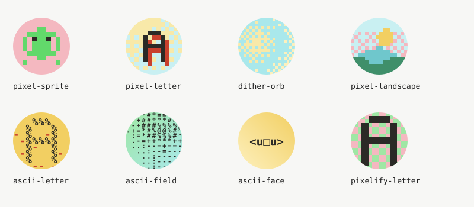

# dither-face

**Turn a stable ID into a pixel or ASCII SVG avatar.** Eight styles, zero runtime dependencies, and no avatar service. dither-face runs in Node and the browser and grew out of [Palletism](https://palletism.art)’s avatar experiments.



## Try it locally

From the repository root, use Node 22.12+ or Node 24 and npm.

```sh
npm ci
npm run build:site
npm run preview:site
```

Open the local URL printed by the preview server. The playground uses the same renderer as the library.

## Use it in an app

Once the npm preview is published, install it with `npm install dither-face`.

```ts
import { ditherFace } from 'dither-face'

const svg = ditherFace('user-123', {
  style: 'pixel-letter',
  name: 'Aditya',
  px: 80,
})

const src = `data:image/svg+xml;charset=utf-8,${encodeURIComponent(svg)}`
```

`ditherFace('user-123')` returns a standalone, 80px `pixel-sprite` SVG. The library is ESM with TypeScript declarations. See the [API reference](docs/API.md) and runnable examples for [plain HTML](examples/browser/index.html), [Node](examples/node/ssr.mjs), and [React](examples/react/Avatar.tsx).

- Use an opaque, stable ID as the seed. Shared playground URLs expose their settings, and different seeds can produce similar avatars.
- Use an image's `alt` text for its accessible name, or `alt=""` when a nearby name already labels it. Data URLs require `data:` in your `img-src` policy. You can also serve the SVG from your own route.
- This is a 0.x source preview. Pin an exact version when persistent identities depend on stable output. ASCII styles use the local system font, so appearance can vary across platforms.

[Contributing](CONTRIBUTING.md) · [Changelog](CHANGELOG.md) · [Security](SECURITY.md) · [Release procedure](.github/RELEASING.md) · [MIT license](LICENSE)
