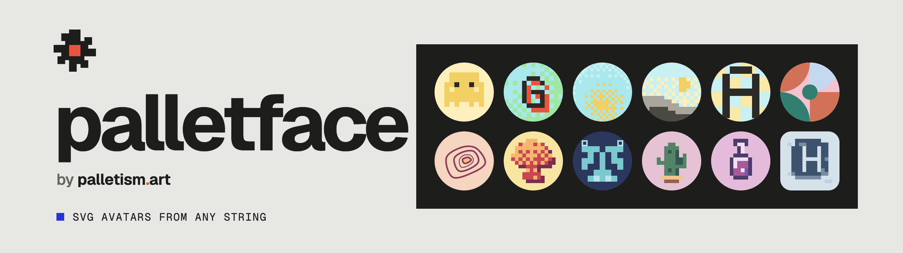
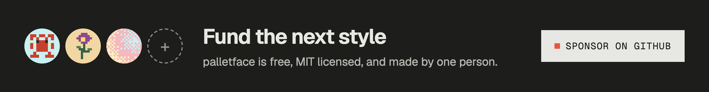

<p align="center">
  
</p>

<p align="center">
  <a href="https://www.npmjs.com/package/palletface"></a>
  <a href="https://github.com/puri-adityakumar/palletface/actions/workflows/ci.yml"></a>
  
  
  <a href="LICENSE"></a>
</p>

<p align="center">
  <a href="https://palletface.palletism.art/docs/"><b>Docs</b></a> ·
  <a href="https://palletface.palletism.art/docs/examples/">Examples</a> ·
  <a href="https://palletface.palletism.art/playground">Playground</a> ·
  <a href="https://www.npmjs.com/package/palletface">npm</a> ·
  <a href="https://github.com/puri-adityakumar/palletface/releases">Releases</a> ·
  <a href="https://palletism.art">Palletism</a> ·
  <a href="https://www.instagram.com/palletism.art/">Instagram</a> ·
  <a href="https://x.com/adityawaslost">X</a> ·
  <a href="https://github.com/sponsors/puri-adityakumar">Sponsor</a>
</p>

**palletface** turns any string, such as a user ID, into a small pixel, dither, or geometric avatar. You get a standalone SVG on the server or in the browser, with no avatar service, image storage, account, or network request. It is an independent, MIT-licensed sister project of [Palletism](https://palletism.art).

## Features

- **Deterministic.** The same seed and options always draw the same SVG.
- **Stable across upgrades.** Minor and patch releases never change existing avatars. Only a major release can.
- **Twelve styles.** Sprites, bitmap letters, dither orbs, landscapes, contours, flora, relics, stamps, and more.
- **Zero runtime dependencies.** Rendering needs no DOM, network, clock, or system randomness.
- **Runs anywhere.** Node, browsers, and server-side rendering, from the same ESM package.
- **Typed.** TypeScript declarations ship with the package.
- **Plain output.** Each call returns a complete SVG string. Use it as an image source, inline it, or serve it from your own route.

## Quick start

```sh
npm install palletface
```

```ts
import { palletface } from 'palletface'

const svg = palletface('user-123', {
  style: 'pixel-letter',
  name: 'Aditya',
  px: 80,
})

// Use as an image without inserting raw HTML.
const src = `data:image/svg+xml;charset=utf-8,${encodeURIComponent(svg)}`
```

`svg` is a complete SVG string with an XML namespace, dimensions, and a viewBox. The same seed and options produce the same output in the tested runtimes. For the simplest call, `palletface('user-123')` uses `pixel-sprite` at 80px.

## Styles


Each row is one style. The first six columns show different seeds, and the last four show the first seed at smaller display sizes.

| `style` | Appearance | Display name used? |
| --- | --- | --- |
| `pixel-sprite` | Mirrored 8×8 creature with ink eyes | No |
| `pixel-letter` | 5×7 bitmap initial, shadow, and dithered background | Yes |
| `dither-orb` | Three-color radial glow made of dithered pixels | No |
| `pixel-landscape` | Tiny sky, sun, and layered hills | No |
| `pixelify-letter` | Bitmap initial over a two-tone checker | Yes |
| `geometric-tile` | Curved color tiles with a seeded palette and rotation | No |
| `random-contours` | Nested topographic lines with seeded shape, spacing, and count | No |
| `pixel-emotes` | Emoji-like pixel silhouettes with dithered shading | No |
| `mirrored-signal` | Symmetric 7×7 identicon with hollow terminals | No |
| `pixel-flora` | 16×16 fern, cactus, or wildflower with seeded shape and colors | No |
| `pixel-relic` | 16×16 key, lantern, or potion with chunky inventory-sprite highlights | No |
| `pixel-stamp` | Bitmap initial cut through a chipped block on a rounded square | Yes |

Use `STYLES` to populate a style picker. Saved `ascii-letter`, `ascii-field`, and `ascii-face` selections remain renderable through `palletface` and their direct exports.

`pixelFlora(seed, px)`, `pixelRelic(seed, px)`, and `pixelStamp(seed, px, name?)` are also available as named exports.

## Options

```ts
import type { PalletfaceOptions, StyleSlug } from 'palletface'
```

| Input | Type | Default | Behavior |
| --- | --- | --- | --- |
| `seed` | `string` | Required | Stable input to the seeded design; empty and Unicode strings are valid |
| `style` | `StyleSlug` | `'pixel-sprite'` | A current style slug or a legacy ASCII slug |
| `px` | `number` | `80` | Positive finite width and height in CSS pixels |
| `name` | `string` | Seed | Initial for Pixel Letter, Pixelify Letter, Pixel Stamp, and legacy ASCII Letter. Seeded colors stay the same. |

Invalid seeds, names, sizes, and unknown styles throw descriptive errors. Initials use the first ASCII letter or digit after accent normalization. Names without one use `?`.

## Integrations

### Browser

```ts
const image = document.querySelector<HTMLImageElement>('#avatar')!
image.src = `data:image/svg+xml;charset=utf-8,${encodeURIComponent(svg)}`
image.alt = 'Aditya’s avatar'
```

Use your existing bundler, or load `node_modules/palletface/dist/palletface.js` with a script tag for the `Palletface` browser global.

### Server-side rendering

```js
import { palletface } from 'palletface'

const svg = palletface('user-123', { style: 'pixel-landscape', px: 80 })
// Send as an SVG response with Content-Type: image/svg+xml,
// or encode it into an image's data URL in your HTML template.
```

Package verification exercises Node against the installed tarball. Core rendering does not use `window`, a DOM, or server APIs.

The [integration docs](https://palletface.palletism.art/docs/integrations/) also show a page without a bundler and a server route that returns the SVG.

## Compatibility, privacy, and accessibility

- **ESM only**, with TypeScript declarations. CI tests Node 22 and 24.
- Pixel styles use SVG geometry. ASCII styles use a system monospace font stack, so glyph shape and layout can vary between platforms. No external font is fetched.
- This is deterministic art, **not cryptography or a uniqueness guarantee**. Hash collisions and visually similar avatars are possible. An avatar is not proof of identity.
- Use an opaque, stable ID. SVGs can reveal initials and generated design details, so keep emails, tokens, and secrets out of seeds.
- For an avatar next to a visible user name, `alt=""` often avoids repetition. Otherwise provide a meaningful label. Generated SVG strings do not include a user-facing accessible name; the embedding application owns it.
- Data URLs require `data:` in your application's `img-src` CSP. If your policy forbids them, serve the SVG from your own route.

## Documentation

The [palletface docs](https://palletface.palletism.art/docs/) cover the [quick start](https://palletface.palletism.art/docs/quick-start/), [examples](https://palletface.palletism.art/docs/examples/), the [API reference](https://palletface.palletism.art/docs/api-reference/), every [style](https://palletface.palletism.art/docs/styles/), and [integrations](https://palletface.palletism.art/docs/integrations/). Try every style in the [playground](https://palletface.palletism.art/playground).

## Development

Use Node 22.12+ or Node 24 and npm, then:

```sh
npm ci
npm run build:web
```

Open `playground/index.html` in your browser. `npm run sheet -- out-sheet` generates the reference SVG sheet, and `npm run check:all` runs the library and installed-package checks. The website and docs live in `site/`.

## Contributing

Bug reports, style ideas, and pull requests are welcome. Read the [contributing guide](CONTRIBUTING.md) before you open a pull request, and follow the [code of conduct](CODE_OF_CONDUCT.md). Report security issues privately as described in the [security policy](SECURITY.md). Maintainers cut releases with the [release runbook](RELEASING.md).

## Community

palletface grew from Palletism's avatar experiments and is independently installable and usable in any application. Palletism's existing avatars are not automatically migrated by this package.

- Palletism: [palletism.art](https://palletism.art) · [Instagram](https://www.instagram.com/palletism.art/)
- Made by Aditya: [X](https://x.com/adityawaslost) · [GitHub](https://github.com/puri-adityakumar)

## Sponsor

<a href="https://github.com/sponsors/puri-adityakumar"></a>

## License

[MIT](LICENSE) © puri-adityakumar
